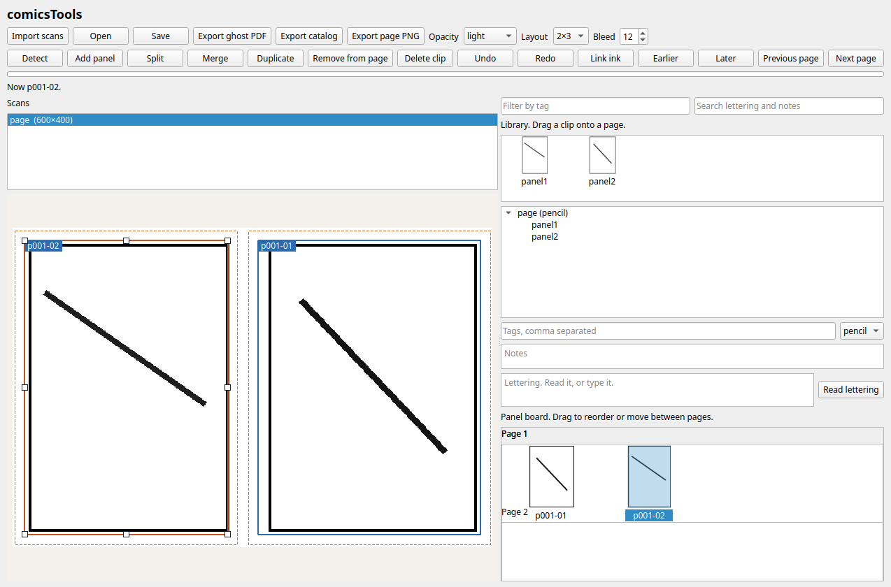
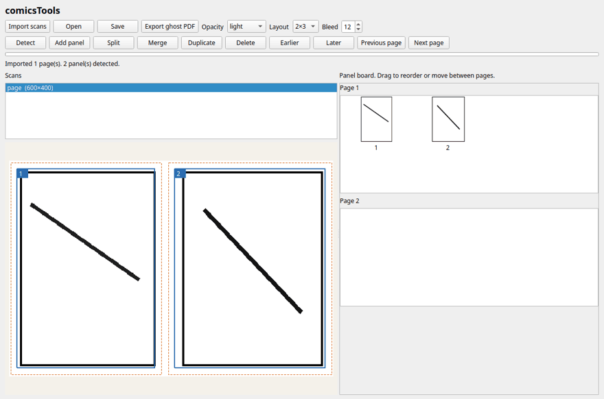

# comicsTools

comicsTools is two programs for cartoonists who print a penciled page, ink it by hand, and scan it back: [comic-cropper](comic-cropper/README.md) frames the panels in the browser, and [pencil_cleaner](pencil_cleaner/README.md) lightens the pencil scan for that print or strips the leftover gray out of the inked scan.

## Download the app





One command from a checkout installs the window and the libraries it uses:

```bash
pip install "./pencil_cleaner[gui]"
```

Start it with `comics-tools`, or `python -m pencil_cleaner gui`.

The window is a clip bin for comic panels. Import copies a scan into the project and does not modify that file, or the file you dropped. A panel is a reference: the source file, a crop rectangle, the deskew angle, and a cleanup setting. Pixels are drawn when the page is shown or exported. They are not written back into the scan.

The library lists every clip, with a thumbnail, tags, notes, and lettering. Filter by tag, or search the notes and the lettering. Drag a clip onto a page. The same clip can be on more than one page. Rearranging a page only changes the layout. Remove from page leaves the clip in the library. Editing the crop updates every place that clip is used. Undo and Redo cover those layout and crop edits.

A layout number follows the page. Page 3, panel 2 is `p003-02`, and the number is assigned again when the layout changes. The clip’s own id does not change.

An ink scan can be linked as another take of the same page. The stage control flips a clip between pencil and ink. Export ghost PDF renders the pencil crops as a US Letter ghost, with corner marks and a printer-test page. Export page PNG renders the current layout. Neither one writes the scan.

Tags, notes, and lettering are stored on the clip. Export catalog writes `catalog.json`, `panels.csv`, and one PNG per layout id (`panels/p001-01.png`). Saving the project also writes `catalog.json` next to `project.json`.

Lettering is read locally with Tesseract, and only when it is installed. [docs/ocr-sample.png](docs/ocr-sample.png) is a label drawn for this check, not a page from a comic. Tesseract 5.3.4 returned:

```
DOCK GATE
```

```bash
sudo apt install tesseract-ocr   # or the Tesseract package for your system
pip install pytesseract
```

If either one is missing, Read lettering leaves the text as it was and the status line says what to install.

The command-line tools below still work. [comic-cropper](comic-cropper/README.md) is still the browser page.

Prebuilt binaries for macOS, Windows, and Linux are built by [`.github/workflows/desktop.yml`](.github/workflows/desktop.yml) when a `v*` tag is pushed, and attached to the GitHub release for that tag. Publishing a release from the GitHub UI builds them too. The macOS app is not notarized. On Linux, if Qt says the platform plugin could not load, install the libraries it names. On Debian or Ubuntu that is `libegl1` and `libxkbcommon-x11-0`.

Not in this window yet: importing the inked scan, registering it on the corner marks, the ink-cleanup slider, SVG trace, and exporting the finished pages as PNG, TIFF, PDF, or SVG. `pencil-cleaner clean` still does the cleanup from the terminal.

Toner is carbon, so dropping a color channel does not remove a laser ghost. The page images stay on the machine that opens them. `pencil_cleaner` is version 0.4.9. The cropper is a static page and has no package version.

| Program | What you use it for |
| --- | --- |
| [`comic-cropper/`](comic-cropper/README.md) | Draw panel rectangles on a scan or PDF. Export them at 1×–4× (default 3×) with bleed, as PNG or JPEG, plus a contact sheet. Save the crops in a `.comiccrop` file. |
| [`pencil_cleaner/`](pencil_cleaner/README.md) | Prep a faint printable ghost, clean an inked scan, score a printer-test sheet, deskew, cut panels on gutters, or clean a page that was printed with four corner marks. |

Shorter task notes, shortcuts, and flags are in those two READMEs.

## Quick start

Python 3.8 or newer for the cleaner. [CI](.github/workflows/ci.yml) runs the unit tests on Ubuntu, Windows, and macOS, on Python 3.11 and 3.12.

### comic-cropper

From `comic-cropper/`:

```bash
python3 -m http.server 8765
```

Open http://127.0.0.1:8765. Any static file server works. The first view loads two pinned scripts from jsDelivr: JSZip 3.10.1 and PDF.js 3.11.174 (the worker is the same version). After that cache, scans and project files are handled in the page.

### pencil_cleaner

From `pencil_cleaner/`:

```bash
python3 -m venv .venv
source .venv/bin/activate   # Windows: .venv\Scripts\Activate.ps1
pip install -e .
```

That installs numpy, `opencv-python-headless`, Pillow, and scipy. Run the commands below from `pencil_cleaner/`, or from any other directory after the install. `python -m pencil_cleaner` still works if your shell is the repository root. `import pencil_cleaner` does not: Python loads the `pencil_cleaner/` folder (and its `app.py`) instead of the installed package.

These commands work with that install:

```bash
python -m pencil_cleaner prep pencils.png -o ghost.png --opacity light
python -m pencil_cleaner clean inked.png -o clean.png --method morphological
python -m pencil_cleaner deskew skewed.png -o straight.png
python -m pencil_cleaner panels page.png -o panels/
```

`opacity` is `light` (0.25), `medium` (0.40), `dark` (0.55), or a float from 0 to 1.

`clean` defaults to `--method vector`. Vector tracing needs the `potrace` binary (`apt install potrace` or `brew install potrace`) and `cairosvg` (`pip install -e ".[svg]"`). Without them, `vector` writes the morphological result and still prints `Wrote …`. `--svg ink.svg` saves the trace, and only on a single image with `--method vector`. PDF input needs PyMuPDF (`pip install -e ".[pdf]"`).

The web app, the terminal UI, corner-mark PDFs, and `gpu-info` need more packages. `pip install -e ".[all]"` installs PyMuPDF, cairosvg, pypdfium2, Gradio, Textual, and Rich. It does not install PyTorch, and it does not install `potrace`.

```bash
pip install -e ".[all]"
pencil-cleaner-app
```

Gradio binds `0.0.0.0` on port 7860. On the same machine open http://127.0.0.1:7860. The method radio in that app is `levels`, `morphological`, and `vector`.

```bash
python -m pencil_cleaner tui
pencil-cleaner-tui
```

`python -m pencil_cleaner gpu-info` needs Rich, which the `tui` extra provides (and `all` includes it). With no CUDA device the table reports CPU. `--method gpu` needs the separate `gpu` extra (`pip install -e ".[gpu]"`, which is PyTorch). If CUDA is not available, that method uses the CPU morphological mask.

`python -m pencil_cleaner marks scan.png -o inked/` looks for four printed corner marks. A scan without them is skipped, and the process exits 1. `printer-test` expects a sheet of vertical gray swatches and a roughly horizontal pen line, not an arbitrary page.

Library calls are the functions exported from `pencil_cleaner`: `prep_pencils_for_printing`, `remove_pencils`, `score_printer_test`, `deskew_flatten`, and `cut_panels`.

## Example

`python -m pencil_cleaner --help` prints:

```
usage: pencil_cleaner [-h]
                      {prep,clean,marks,printer-test,deskew,panels,app,gui,tui,gpu-info}
                      ...

positional arguments:
  {prep,clean,marks,printer-test,deskew,panels,app,gui,tui,gpu-info}
    prep                lighten a pencils-only scan for printing/inking
    clean               strip pencil ghosts from an inked scan
    marks               clean scans of pages printed with corner registration
                        marks
    printer-test        score a grey-swatch printer test sheet and recommend
                        opacity
    deskew              deskew and/or flatten lighting (no pencil stripping)
    panels              cut comic panels into separate PNGs
    app                 launch the Gradio web app
    gui                 open the desktop window
    tui                 launch the interactive terminal user interface (TUI)
    gpu-info            display NVIDIA GPU hardware and acceleration status

options:
  -h, --help            show this help message and exit
```

The three runs below used drawings made for the check, not a scanned comic. `pencils.png` and `inked.png` are 400×300. `page.png` is 600×400.

```
$ python -m pencil_cleaner prep pencils.png -o ghost.png --opacity light
Wrote ghost.png

$ python -m pencil_cleaner clean inked.png -o clean.png --method morphological
Wrote clean.png

$ python -m pencil_cleaner panels page.png -o panels/
Cut 2 panel(s):
  panels/panel_01.png
  panels/panel_02.png
Overview: panels/panels_overview.png
```

`pencils.png` was white with one gray stroke whose darkest pixel was 170 (255 is white). After `prep --opacity light`, the darkest pixel in `ghost.png` was 191.

`inked.png` had an 8 px black stroke and a separate 2 px gray stroke. `clean --method morphological` left the black stroke (2,728 pixels under 80, the same count as the input) and removed the gray stroke (682 pixels between 100 and 220). The default `min_stroke_px` is 5, tuned in `build_ink_mask` for about 300 dpi, so a hairline thinner than that kernel is removed with the ghost.

`page.png` was two black rectangles with a white gutter between them. `panels` wrote two PNGs and an overview.

On a machine with the `tui` extra installed and no CUDA device, `python -m pencil_cleaner gpu-info` prints:

```
         pencil_cleaner GPU          
┏━━━━━━━━━━━━━━━━━━━┳━━━━━━━━━━━━━━━┓
┃ Property          ┃ Value         ┃
┡━━━━━━━━━━━━━━━━━━━╇━━━━━━━━━━━━━━━┩
│ Available         │ False         │
│ Device Name       │ CPU (No CUDA) │
│ Vram Total Gb     │ 0.0           │
│ Vram Allocated Gb │ 0.0           │
│ Vram Reserved Gb  │ 0.0           │
│ Cuda Version      │ N/A           │
└───────────────────┴───────────────┘
```

## Tests

`python -m unittest discover tests` runs the three checks in `tests/test_pencil_cleaner.py`: `load_gray` on a flat mid-gray PNG, `flatten_lighting` on a horizontal gradient, and `estimate_skew_angle` on a blank white field. The suite does not run potrace, CUDA, the cropper, printer scoring, or panel cutting.

## License

MIT. See [LICENSE](LICENSE).
